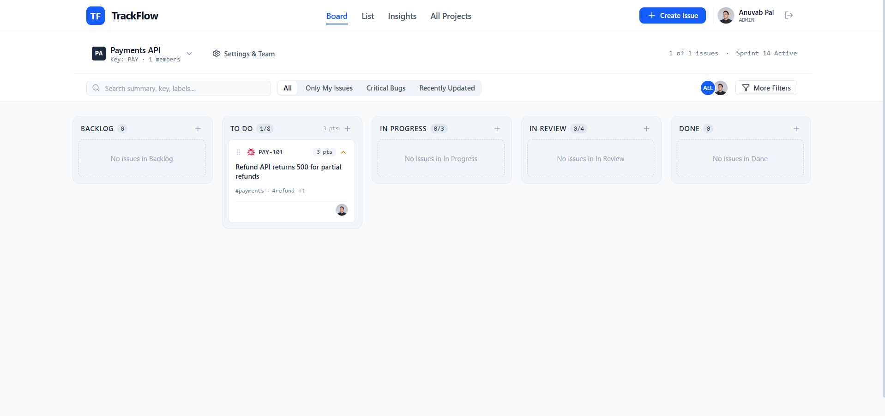
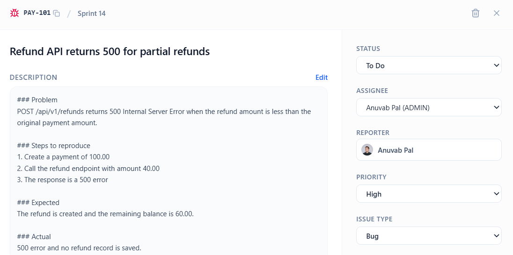
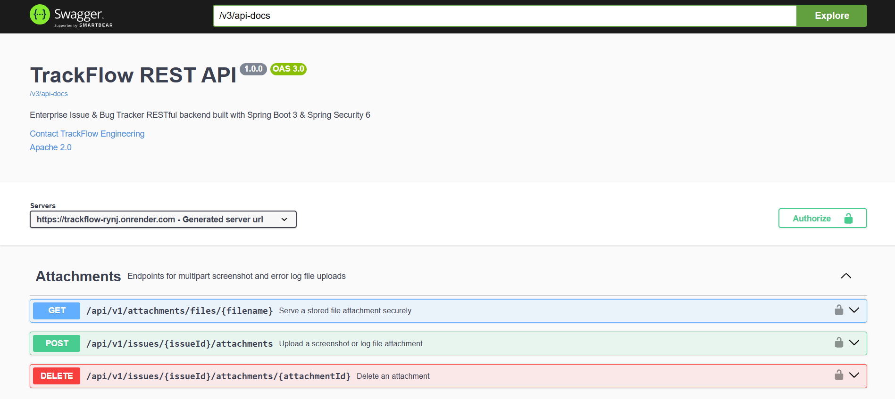

# TrackFlow — Bug & Issue Tracker

A Jira-like issue tracking system. Teams create projects, manage members, report and assign issues, move them across a drag-and-drop Kanban board, discuss them in comments and attach screenshots. Access is controlled by JWT authentication, three user roles and per-project membership checks enforced on the backend.

**Live demo:** https://trackflow-issue-tracker.vercel.app  
**API docs (Swagger):** https://trackflow-rynj.onrender.com/swagger-ui.html

> The backend runs on Render's free tier and sleeps when idle. The first request after a pause can take up to a minute while it wakes up.

## Screenshots

| Board | Issue detail | API docs |
|---|---|---|
|  |  |  |

---

## Features

- **Kanban board** with five columns (`Backlog`, `To Do`, `In Progress`, `In Review`, `Done`) and drag-and-drop built with `@dnd-kit` (mouse and touch). Status changes are saved to the database.
- **Authentication:** register and login with BCrypt-hashed passwords and stateless JWT tokens.
- **Role-based access control**
  - **ADMIN:** everything, including deleting projects and changing user roles.
  - **MANAGER:** create projects, manage members, delete issues.
  - **DEVELOPER:** create issues and comments; edit only issues assigned to or reported by them.
- **Project membership:** users can only see and change projects they belong to (ADMIN can access all).
- **Issues:** type (bug, story, task, epic), priority, status, assignee, story points, labels and descriptions.
- **Comments and attachments:** discussion thread per issue and screenshot or log uploads (type and size validation, path-traversal protection).
- **Search and filters:** search by title, key or label; filter by type, priority and assignee; board, list and insights views.
- **API documentation:** interactive Swagger UI generated with Springdoc OpenAPI.

---

## Tech Stack

**Frontend:** React 19, TypeScript, Vite, React Router, Tailwind CSS, `@dnd-kit`, Axios (JWT interceptor), Lucide icons.

**Backend (`/backend`):** Java 17, Spring Boot 3, Spring Security 6 + JWT, Spring Data JPA / Hibernate, Maven, Springdoc OpenAPI.

**Database:** PostgreSQL on Neon. H2 (in-memory) is used only by the automated tests.

**Deployment:** Render (Docker, backend), Vercel (frontend), Neon (database).

---

## Project Structure

```
├── backend/                  # Spring Boot REST API
│   ├── src/main/java/        # controllers, services, entities, DTOs, security config
│   ├── src/main/resources/   # application.yml (single config file)
│   ├── src/test/             # tests (H2 in-memory config)
│   ├── Dockerfile            # multi-stage container build
│   └── pom.xml
├── frontend/                 # React application source
│   ├── api/                  # Axios client and API modules
│   ├── components/           # Kanban board, list view, modals, navbar
│   ├── context/              # app state and permission checks
│   ├── pages/                # login, register, projects, project view
│   └── types/                # TypeScript interfaces
├── docs/screenshots/         # README images
├── index.html, package.json, vite.config.ts, tsconfig.json
├── vercel.json               # SPA routing rewrite for Vercel
└── .env.example              # frontend environment template
```

---

## Running Locally

**Prerequisites:** Java 17, Maven, Node.js 20+ and a PostgreSQL database (for example a free Neon project).

### 1. Backend

The database URL and user are set in `backend/src/main/resources/application.yml`. Point them at your own database, then set two environment variables so no secret is stored in the code.

```powershell
# Windows PowerShell (one time, then reopen the terminal)
[Environment]::SetEnvironmentVariable("TF_PASSWORD", "your-database-password", "User")
[Environment]::SetEnvironmentVariable("JWT_SECRET", "a-random-string-of-at-least-32-characters", "User")

cd backend
mvn spring-boot:run
```

The API runs at `http://localhost:8080/api/v1` and Swagger UI at `http://localhost:8080/swagger-ui.html`.

### 2. Frontend

From the repository root:

```bash
npm install
npm run dev
```

The app runs at `http://localhost:3000`. It calls `http://localhost:8080/api/v1` by default; set `VITE_API_URL` to use another backend.

### 3. Tests

```bash
cd backend
mvn test
```

Tests use their own in-memory H2 configuration and never touch the real database.

---

## First Admin Account

There are no default accounts. Registration always creates a `DEVELOPER`, so the first administrator is promoted once in the database:

1. Register through the app (`/register`).
2. Run in the database SQL console: `UPDATE users SET role = 'ADMIN' WHERE email = 'your@email.com';`
3. Log out and log in again to get a token with the ADMIN role.

Admins can then change other users' roles through `PUT /api/v1/users/{id}/role`.

---

## Deployment

### Backend (Render, Docker)

Root directory `backend`, runtime Docker. Environment variables:

| Variable | Description |
|---|---|
| `TF_PASSWORD` | Database password |
| `JWT_SECRET` | Signing key, at least 32 bytes; startup fails if missing |
| `CORS_ALLOWED_ORIGINS` | Allowed frontend origin, for example `https://trackflow-issue-tracker.vercel.app` (no trailing slash) |
| `JAVA_TOOL_OPTIONS` | `-Xmx300m` to stay within the 512 MB free-tier memory |
| `PORT` | Set automatically by Render |
| `UPLOAD_DIR` | Attachment storage path (optional, default `./uploads`) |

### Frontend (Vercel)

Root directory is the repository root, framework Vite. Environment variable:

| Variable | Value |
|---|---|
| `VITE_API_URL` | `https://<your-render-service>.onrender.com/api/v1` |

### Docker

```bash
cd backend
docker build -t trackflow-backend:latest .
```

---

## Security Notes

- Passwords are hashed with BCrypt; sessions use stateless JWT. There is no hardcoded JWT secret.
- Roles and project membership are enforced in the service layer, not only in the UI.
- Registration cannot create privileged accounts; roles are changed only by an admin.
- Attachment downloads are public by unguessable UUID filename, because `` tags cannot send a Bearer token. Signed URLs would be the production fix.
- Uploaded files on Render's free tier are ephemeral and are lost on redeploy. Use object storage (for example S3) or a persistent disk in production.
- The schema is managed with `ddl-auto: update`. A production system would use migrations (for example Flyway).

---

## Known Limitations

- Activity history is not recorded by the backend yet, so the activity tab is empty.
- The sprint label on the board is a static display element, not a sprint-planning feature.

---

## License

Apache-2.0